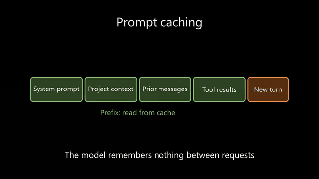
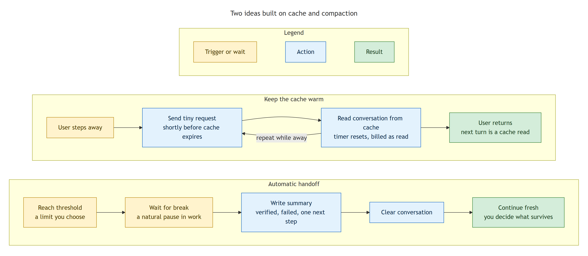
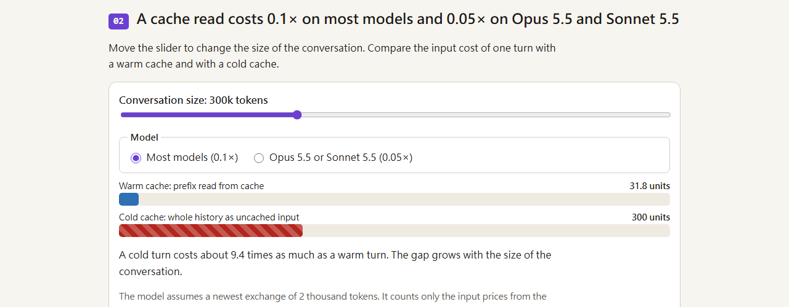

# understanding-ai-outputs

**Ask your agent for a diagram, a web page or a narrated video instead of another wall of text.** Four Claude Code
skills that follow the format ladder from Andrej Karpathy's X post ([our summary](reference/karpathy-x-post.md)).

<p align="center">
  <a href="docs/demo/prompt-cache.mp4"></a>
  <br><sub>Made by <code>video-explainer</code> from one answer, no edits. <a href="docs/demo/prompt-cache.mp4">Watch the 92-second video</a> (sound on).</sub>
</p>

## One answer, four formats

We gave the same answer to each skill: *why long Claude Code sessions get slow and expensive, and how an automatic
handoff and keeping the cache warm help* ([the answer, the four requests and the costs](docs/demo/README.md)).

| You ask | You get |
| --- | --- |
| **"Rewrite this answer in STE."**<br>`ste-writing` | Before: *"Because the model does not remember anything between requests, Claude Code re-sends the entire context on every turn, including the system prompt, your project context and every prior message and tool result, and it relies on prompt caching so that …"* (one 86-word sentence)<br>After: *"The model does not remember anything between requests. Thus, Claude Code sends the full context again on every turn."* ([full text](docs/demo/prompt-cache-ste.md)) |
| **"Draw a diagram of this answer."**<br>`diagram-explainer` | <br>Mermaid source included ([second diagram](docs/demo/prompt-cache-diagram-1.png)) |
| **"Make an interactive HTML page that explains this answer."**<br>`html-explainer` | <a href="https://norton77930.github.io/understanding-ai-outputs/demo/prompt-cache/"></a><br>Six sections with sliders, a guess-first question and step-through animations. **[Try it live](https://norton77930.github.io/understanding-ai-outputs/demo/prompt-cache/)** |
| **"Make a short explainer video of this answer."**<br>`video-explainer` | 92 seconds, 6 scenes, English narration (Kokoro, offline), captions as `.srt`. **[Watch it](docs/demo/prompt-cache.mp4)** |

## Quick start (Claude Code)

```bash
claude plugin marketplace add norton77930/understanding-ai-outputs
claude plugin install understanding-ai-outputs@norton77930
```

Then ask in any session: "explain this in STE", "draw a diagram of this", "make an interactive page of this" or
"make an explainer video of this". Each skill starts only when you ask for its format. Codex, Cursor and other agents:
see [Installation](#installation).

## The format ladder

As agents do more of the work, we spend more time reading and checking what they produce. The post suggests a
**format ladder**. Each step costs more to produce and is faster to understand:

1. **STE writing**: explain in Simplified Technical English.
2. **Diagram**: ask for a diagram instead of prose.
3. **Web page**: ask for the output as an interactive HTML page.
4. **Explainer video**: ask for a narrated, 3Blue1Brown-style video.

Each step is its own skill. Install only the ones you need.

## Skills

| Skill | What it does | Needs |
| --- | --- | --- |
| `ste-writing` | Writes or rewrites text in a relaxed Simplified Technical English style | Nothing extra |
| `diagram-explainer` | Turns a topic or an answer into one to three small Mermaid diagrams (flowchart, sequence, state) with a caption | Nothing extra; a Chromium browser and uv for PNG |
| `html-explainer` | Turns a topic or an answer into one self-contained interactive web page | Nothing extra; a Chromium browser and uv for the render check |
| `video-explainer` | Turns a topic or an answer into a narrated video (MP4, captions, script), from a one-minute summary to a 5 to 10 minute deep dive | uv and ffmpeg |

`ste-writing` is inspired by ASD-STE100. It is not official and is not endorsed by ASD. The skill uses its own
rules and its own replacement list, not the ASD-STE100 dictionary ([ADR 0001](docs/adr/0001-third-party-reference-material-stays-local.md)).

## How this project works

- **One format, one skill.** Each skill starts only when you ask for its format: "draw a diagram", "make an
  interactive page", "make a video", "explain in STE". It never picks a format for you. A 20-query trigger eval for
  each skill checks this (all four pass 20/20).
- **The model designs, scripts check.** Early versions with strict layout rules lost to Claude without the skill in
  blind tests. The skills now leave the design to the model and keep checker scripts as a floor: Mermaid syntax and
  label length, page render on phone and desktop in light and dark mode, video captions and audio sync.
- **Evidence from blind ratings.** The maintainer rates the rendered output (the image, the page, the video), not the
  source, without knowing which one the skill made. Each round uses new topics. Latest round against Claude without
  the skill:

| Skill | Latest blind round | Result |
| --- | --- | --- |
| `ste-writing` | 4 explain topics (zh-TW) | 2 wins, 1 tie, 1 loss. Without the skill, Claude answered all four zh-TW requests in English. |
| `diagram-explainer` | 4 topics, round 2 | 2 wins, 1 tie, 1 loss. Presentation 4.75 vs 4.5. |
| `html-explainer` | 4 topics, round 3 | 1 win, 3 ties. The baseline won rounds 1 and 2; removing the fixed page style closed the gap. |
| `video-explainer` | 2 topics with a baseline | 2 wins. Presentation 5 vs 4. |

The full runs, costs and losses are in each skill's `evals/<skill>/RESULTS.md`.

Related projects: [ELI5](https://github.com/anthropics/claude-plugins-community) (Anthropic's community plugins),
[answer-me-with-html](https://github.com/QingYunA/answer-me-with-html).

## Using video-explainer

Ask for a video explicitly, for example "make an explainer video of this answer" or "做一支解釋 TCP 握手的短影片". The
skill asks at most two short questions (depth and audience) and skips what your request already says ("3b1b" or
"deep dive" means deep). Modes: quick (about 1 minute), standard (2 to 4 minutes, default) and deep (5 to 10 minutes).
It writes a storyboard and shows you the mode, the scene count, the full narration, the estimated length and render
time, and any model download with its size. It renders only after you approve. You get `video.mp4`, `video.srt` and `script.md`
in `out/video-explainer/<slug>/`.

- Needs [uv](https://docs.astral.sh/uv/) and ffmpeg. The plugin installs nothing. ManimCE and the narration engines
  arrive through `uv run` on first use, and the skill's doctor script reports what your machine can do.
- Narration: English uses Kokoro (offline, Apache-2.0). Traditional Chinese uses edge-tts with a Taiwan voice, and
  falls back to Kokoro (mainland accent) without network.
- Output presets: `explainer` (16:9, 720p, default), `youtube` (16:9, 1080p) and `short` (9:16, captions burned in).
- Before you upload a video, read "Before you publish" in
  [`narration-engines.md`](skills/video-explainer/references/narration-engines.md): edge-tts uses an unofficial
  endpoint.
- To keep caches off your system drive, set `UV_CACHE_DIR` and `VIDEO_EXPLAINER_CACHE`.

## Using diagram-explainer

Ask for a diagram explicitly, for example "draw a diagram of this answer", "show this as a sequence diagram" or
"畫一張圖說明 git rebase". The skill picks the diagram type from your question (a pipeline reads left to right), sizes
the diagram to the topic and splits it only when the rendered image is hard to read. Each diagram has a title, labels
with a short name and one detail line, colors with a fixed meaning (for example pass green, fail red) explained by a
legend, and one caption line that says what to look at. You get the Mermaid code in the reply, and `diagram.mmd` and
`caption.md` in `out/diagram-explainer/<slug>/`.

- Only `flowchart`, `sequenceDiagram` and `stateDiagram-v2`, in syntax that renders on GitHub and in common tools. A
  stdlib checker script checks every diagram before you see it.
- Optional rendering to `diagram.svg` and `diagram.png` needs [uv](https://docs.astral.sh/uv/), network access, and
  Google Chrome, Microsoft Edge or Playwright's Chromium. The skill never downloads a browser without asking you. Without
  a browser, you still get the checked Mermaid source.
- Labels follow the STE principles. They are inspired by ASD-STE100, are not official and are not endorsed by ASD.
- D2 or Graphviz only when you ask for them and have them installed.

## Using html-explainer

Ask for an interactive page explicitly, for example "make an interactive page that explains binary search" or
"做一個互動網頁說明 TCP 三次握手". The skill picks an interaction that fits the idea (step-through, slider, layer toggles
or reveal) and writes one `index.html` in `out/html-explainer/<slug>/`. Open it with a double-click: no build, no
server, no install.

- The page has no external resources by default. A library, if necessary, comes only from cdnjs, jsDelivr or unpkg at a
  pinned version.
- The page fits a 390 px phone screen, follows your light or dark system setting and works with the keyboard.
- A static check (Python standard library) runs on every page. A render check then loads the page in a headless
  browser, fails on console errors or horizontal scroll, and saves phone and desktop screenshots in light and dark mode
  for a layout check.
- The render check needs [uv](https://docs.astral.sh/uv/) and a Chromium browser: Playwright's Chromium, Google Chrome
  or Microsoft Edge. It never downloads a browser. Without one, the skill skips the render check and tells you why.
  Set `PLAYWRIGHT_BROWSERS_PATH` to choose where Playwright's browsers go.

## Installation

Pick one route. Installing both gives you every skill twice.

<details>
<summary><strong>Claude Code</strong></summary>

```bash
claude plugin marketplace add norton77930/understanding-ai-outputs
claude plugin install understanding-ai-outputs@norton77930
```

Or, from inside a session:

```
/plugin marketplace add norton77930/understanding-ai-outputs
/plugin install understanding-ai-outputs@norton77930
```

</details>

<details>
<summary><strong>Codex, Cursor, and other agents</strong></summary>

```bash
npx skills@latest add norton77930/understanding-ai-outputs
```

To install one skill only:

```bash
npx skills@latest add norton77930/understanding-ai-outputs --skill=ste-writing
```

</details>

## Contributing

See [CONTRIBUTING.md](CONTRIBUTING.md). Release notes are in [CHANGELOG.md](CHANGELOG.md).

## License

[MIT](LICENSE). Copyright (c) 2026 Norton Deng.
