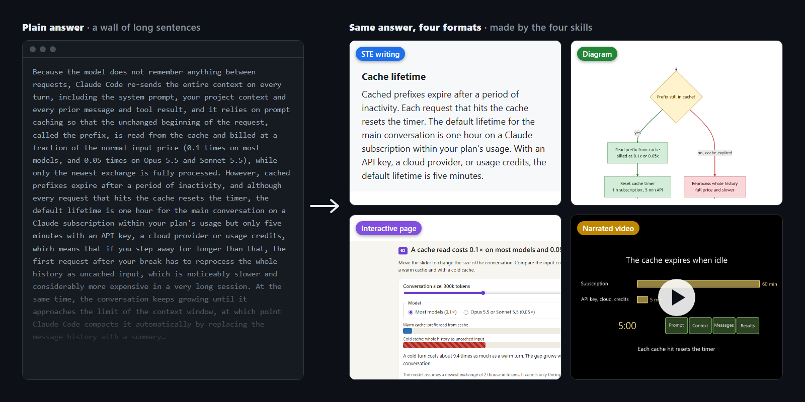

<p align="center">
  
</p>

<h1 align="center">understanding-ai-outputs</h1>

<p align="center">
  <b>STE 寫作&nbsp;&nbsp;|&nbsp;&nbsp;圖&nbsp;&nbsp;|&nbsp;&nbsp;互動網頁&nbsp;&nbsp;|&nbsp;&nbsp;旁白解說影片&nbsp;&nbsp;|&nbsp;&nbsp;盲評驗證</b>
</p>

<p align="center">
  
</p>

<p align="center">
  <b>請 agent 給你一張圖、一個網頁或一支有旁白的影片，而不是又一大段文字。</b><br>
  四個 agent skill，依照 Andrej Karpathy 談「看懂 LLM 產出」的
  <a href="https://x.com/karpathy/status/2105819303471976479">貼文</a>裡提出的格式階梯來做。
</p>

<p align="center">
  <a href="https://github.com/norton77930/understanding-ai-outputs/releases"></a>
  <a href="https://github.com/norton77930/understanding-ai-outputs/actions/workflows/validate.yml"></a>
  
  <a href="LICENSE"></a>
</p>

<p align="center">
  <a href="#安裝"><b>安裝</b></a> · <a href="#同一個回答四種格式">示範</a> · <a href="#為什麼不直接問-claude">為什麼</a> · <a href="#四個-skill">Skill</a> · <a href="docs/demo/README.md">示範怎麼做的</a> · <a href="README.md">English</a>
</p>

裝好之後，照平常的方式問，再說出你想要的格式：

```
> 用 STE 解釋上面的回答
> 畫一張圖，說明這個請求怎麼經過各個服務
> 做一個互動網頁說明二分搜尋
> 用 3b1b 風格做一支 TCP 三次握手的解說影片
```

每種格式是一個獨立的 skill，只有你要求那種格式時才會啟動。下面是影片 skill 的實際產出：

https://github.com/user-attachments/assets/36cdba42-4a24-4bba-a807-0db2ac08b58c

<p align="center"><sub>92 秒，由 <code>video-explainer</code> 從一個回答直接做出來，沒有人工修改。請開聲音，旁白是英文。這裡無法播放的話，<a href="https://norton77930.github.io/understanding-ai-outputs/demo/prompt-cache.mp4">點這裡開啟影片</a>。</sub></p>

## 為什麼不直接問 Claude

可以直接問。沒裝這些 skill 的 Claude 也能畫出不錯的圖、網頁，甚至影片。所以我們用盲評檢查 skill 多常做得更好：維護者看實際產出（圖、網頁、影片）來評分，評分時不知道哪一個是 skill 做的，而且每一輪都換新主題。

| Skill | 最近一輪，對上沒裝 skill 的 Claude | 結果 |
| :--- | :--- | :--- |
| `ste-writing` | 4 個解釋題，用繁體中文提問 | **2 勝 1 平 1 負。** 沒裝 skill 時，Claude 4 題都用英文回答 |
| `diagram-explainer` | 4 個主題 | **2 勝 1 平 1 負。** 呈現分數 4.75 比 4.5 |
| `html-explainer` | 4 個主題，第 3 輪 | **1 勝 3 平。** 前兩輪都輸給 baseline，拿掉固定版型後才追平 |
| `video-explainer` | 2 個主題 | **2 勝。** 呈現分數 5 比 4 |

skill 補上的，是自己手動問時容易漏掉的部分：

| 什麼情況 | 自己手動問 | 用 skill |
| :--- | :--- | :--- |
| 圖的標籤很長 | 標籤可能超出方框，流水線可能畫成由上往下（我們的測試都遇過） | 檢查腳本先擋下過長的標籤和語法錯誤，你才會看到圖 |
| 網頁在筆電上看起來沒問題 | 手機上可能左右捲動，或沒有深色模式（測試中有一個 baseline 網頁沒有深色模式） | 渲染檢查會用 390 px 和 1280 px、淺色和深色各載入一次，有主控台錯誤就不通過 |
| 你要一支影片 | agent 自己決定長度，不問就開始渲染（測試中有一次 baseline 在最終渲染前就結束了） | 先給你看 storyboard，附上長度和渲染時間，你同意才渲染；字幕會跟旁白逐場比對 |
| 用中文要求 STE | 我們的測試中，Claude 4 次都用英文回答 | 用你的語言套用 STE 原則 |

每一次執行、費用和輸掉的回合，都記在 `evals/<skill>/RESULTS.md`。每個 skill 也都通過 20 題的觸發測試：你要求它的格式時會啟動，其他時候不會。

## 安裝

**Claude Code**（四個 skill 一起裝）：

```bash
claude plugin marketplace add norton77930/understanding-ai-outputs
claude plugin install understanding-ai-outputs@norton77930
```

也可以在 session 裡輸入：`/plugin marketplace add norton77930/understanding-ai-outputs`，再輸入
`/plugin install understanding-ai-outputs@norton77930`。

**Codex、Cursor 和其他 agent**，透過 [vercel-labs/skills](https://github.com/vercel-labs/skills) 安裝：

```bash
npx skills@latest add norton77930/understanding-ai-outputs                       # 四個都裝
npx skills@latest add norton77930/understanding-ai-outputs --skill=ste-writing   # 只裝一個
```

兩種方式擇一就好，兩種都裝的話每個 skill 會出現兩次。`ste-writing` 不需要其他工具；其他 skill 只有部分步驟需要額外工具，列在[四個 skill](#四個-skill)。

## 同一個回答，四種格式

我們把同一個回答交給四個 skill：*為什麼長時間的 Claude Code 對話會變慢、變貴，以及自動交接和快取保溫怎麼幫忙*（[原始回答、四個請求和費用](docs/demo/README.md)）。示範內容是英文。

| 你說 | 你得到 |
| :--- | :--- |
| **「Rewrite this answer in STE.」**<br>`ste-writing` | 改寫前：*"Because the model does not remember anything between requests, Claude Code re-sends the entire context on every turn, including the system prompt, your project context and every prior message and tool result, and it relies on prompt caching so that …"*（一句 86 個字）<br>改寫後：*"The model does not remember anything between requests. Thus, Claude Code sends the full context again on every turn."*（[全文](docs/demo/prompt-cache-ste.md)） |
| **「Draw a diagram of this answer.」**<br>`diagram-explainer` | <br>附 Mermaid 原始碼（[第二張圖](docs/demo/prompt-cache-diagram-1.png)） |
| **「Make an interactive HTML page that explains this answer.」**<br>`html-explainer` | <a href="https://norton77930.github.io/understanding-ai-outputs/demo/prompt-cache/"></a><br>六個段落，有滑桿、先猜猜看的小問題和逐步播放的動畫。**[線上試玩](https://norton77930.github.io/understanding-ai-outputs/demo/prompt-cache/)** |
| **「Make a short explainer video of this answer.」**<br>`video-explainer` | 92 秒、6 個場景，英文旁白（Kokoro，離線），字幕另存成 `.srt`。**[觀看影片](https://norton77930.github.io/understanding-ai-outputs/demo/prompt-cache.mp4)** |

## 四個 skill

Karpathy 的貼文提出一個**格式階梯**：越往上越花工夫做，但越快看懂。每一階是一個 skill，只裝你需要的就好。

| Skill | 怎麼要求 | 你會得到 | 需要 |
| :--- | :--- | :--- | :--- |
| `ste-writing` | 「用 STE 解釋」「用 STE 改寫這段」 | 寬鬆版簡化技術英文（Simplified Technical English）風格的文字；中文對話會用中文套用相同原則 | 不需要 |
| `diagram-explainer` | 「畫一張圖說明這個」 | 1 到 3 張 Mermaid 圖（流程圖、時序圖、狀態圖），附圖例和一句說明 | 不需要；轉 PNG 需要 uv 和 Chromium 瀏覽器 |
| `html-explainer` | 「做一個互動網頁說明這個」 | 一個獨立的 `index.html`，有逐步播放、滑桿、切換或展開 | 不需要；渲染檢查需要 uv 和 Chromium 瀏覽器 |
| `video-explainer` | 「做一支解說影片」 | MP4、字幕和旁白稿：快速（約 1 分鐘）、標準（2 到 4 分鐘）或深入（5 到 10 分鐘） | uv 和 ffmpeg |

`ste-writing` 的靈感來自 ASD-STE100，但不是官方版本，也沒有 ASD 背書。這個 skill 使用自己的規則和替換清單，不使用 ASD-STE100 字典（[ADR 0001](docs/adr/0001-third-party-reference-material-stays-local.md)）。

<details>
<summary><b>video-explainer 詳細說明</b></summary>

要明確說你要影片，例如「把這個回答做成解說影片」或「做一支解釋 TCP 握手的短影片」。skill 最多問兩個簡短問題（深度和觀眾程度），你的請求已經說了的就不問，例如寫了「3b1b」或「deep dive」就直接用深入模式。接著它寫一份 storyboard 給你看：模式、場景數、每一場的完整旁白、預估長度和渲染時間，以及需要下載的模型和大小。你同意後才開始渲染。產出是 `out/video-explainer/<slug>/` 裡的 `video.mp4`、`video.srt` 和 `script.md`。

- 需要 [uv](https://docs.astral.sh/uv/) 和 ffmpeg。plugin 本身不安裝任何東西。ManimCE 和旁白引擎會在第一次使用時透過 `uv run` 取得，skill 的 doctor 腳本會先告訴你這台電腦能做什麼。
- 旁白：英文用 Kokoro（離線，Apache-2.0）。繁體中文用 edge-tts 的台灣口音；沒有網路時改用 Kokoro（中國大陸口音）。
- 輸出格式：`explainer`（16:9、720p，預設）、`youtube`（16:9、1080p）和 `short`（9:16，字幕燒進畫面）。
- 上傳影片前，請先讀 [`narration-engines.md`](skills/video-explainer/references/narration-engines.md) 的「Before you publish」：edge-tts 走的是非官方的服務端點。
- 想讓快取不要放在系統磁碟，可以設定 `UV_CACHE_DIR` 和 `VIDEO_EXPLAINER_CACHE`。

</details>

<details>
<summary><b>diagram-explainer 詳細說明</b></summary>

要明確說你要圖，例如「畫一張圖說明這個回答」「用時序圖表示」或「畫一張圖說明 git rebase」。skill 會依你的問題選圖的類型（流水線一律由左到右），依主題決定圖的大小，只有渲染出來不好讀時才拆成多張。每張圖都有標題；標籤是一個短名稱加一行細節；顏色有固定意思（例如通過是綠色、失敗是紅色），並用圖例說明；最後附一句話告訴你該看哪裡。回覆裡會附 Mermaid 原始碼，`out/diagram-explainer/<slug>/` 裡有 `diagram.mmd` 和 `caption.md`。

- 只用 `flowchart`、`sequenceDiagram` 和 `stateDiagram-v2`，語法在 GitHub 和常見工具上都能顯示。每張圖在給你看之前，都會先用只依賴標準函式庫的檢查腳本檢查。
- 轉成 `diagram.svg` 和 `diagram.png` 是選用功能，需要 [uv](https://docs.astral.sh/uv/)、網路，以及 Google Chrome、Microsoft Edge 或 Playwright 的 Chromium。skill 不會在沒問你的情況下下載瀏覽器。沒有瀏覽器時，你一樣會拿到檢查過的 Mermaid 原始碼。
- 標籤遵守 STE 原則。這些原則的靈感來自 ASD-STE100，不是官方版本，也沒有 ASD 背書。
- 只有你指定、而且電腦上有安裝時，才會用 D2 或 Graphviz。

</details>

<details>
<summary><b>html-explainer 詳細說明</b></summary>

要明確說你要互動網頁，例如「做一個互動網頁說明二分搜尋」或「做一個互動網頁說明 TCP 三次握手」。skill 會依內容挑合適的互動方式（逐步播放、滑桿、圖層切換或展開），在 `out/html-explainer/<slug>/` 寫出一個 `index.html`。直接雙擊就能打開，不需要建置、伺服器或安裝。

- 網頁預設不載入任何外部資源。真的需要函式庫時，只從 cdnjs、jsDelivr 或 unpkg 載入固定版本。
- 網頁適合 390 px 的手機螢幕，會跟著你系統的淺色或深色設定，也可以只用鍵盤操作。
- 每個網頁都會先做靜態檢查（只用 Python 標準函式庫）。接著渲染檢查會用無頭瀏覽器載入網頁，有主控台錯誤或左右捲動就不通過，並存下手機和桌面、淺色和深色的截圖，用來檢查版面。
- 渲染檢查需要 [uv](https://docs.astral.sh/uv/) 和 Chromium 瀏覽器：Playwright 的 Chromium、Google Chrome 或 Microsoft Edge。它不會下載瀏覽器；沒有瀏覽器時，skill 會跳過渲染檢查並告訴你原因。可以用 `PLAYWRIGHT_BROWSERS_PATH` 指定 Playwright 瀏覽器的位置。

</details>

## 這個專案的做法

- **一種格式，一個 skill。** 只有你說出某種格式時，對應的 skill 才會啟動，它不會替你決定格式。
- **模型負責設計，腳本負責檢查。** 早期版本的版面規則訂得太死，盲評時輸給沒裝 skill 的 Claude。現在設計交給模型，檢查腳本只守住最低品質。
- **用證據說話。** skill 的每次修改都用實際產出做盲評，輸掉的結果也保留在紀錄裡。

## 背景

Andrej Karpathy 在[貼文](https://x.com/karpathy/status/2105819303471976479)裡說，agent 做的事越來越多，我們有越來越多時間花在看懂它們的產出。他建議幾種比文字更好懂的格式，由淺到深是：STE 寫作、圖、互動網頁和解說影片（[我們的摘要](reference/karpathy-x-post.md)）。這個專案把每一階做成可以安裝、測試和改進的 skill。

相關專案：[ELI5](https://github.com/anthropics/claude-plugins-community)（Anthropic 的社群 plugin）、[answer-me-with-html](https://github.com/QingYunA/answer-me-with-html)。

## 參與貢獻

請看 [CONTRIBUTING.md](CONTRIBUTING.md)。版本紀錄在 [CHANGELOG.md](CHANGELOG.md)。想法和錯誤回報請開 [issue](https://github.com/norton77930/understanding-ai-outputs/issues/new/choose)。

## Star History

<a href="https://star-history.com/#norton77930/understanding-ai-outputs&Date">
  <picture>
    <source media="(prefers-color-scheme: dark)" srcset="https://api.star-history.com/svg?repos=norton77930/understanding-ai-outputs&type=Date&theme=dark" />
    <source media="(prefers-color-scheme: light)" srcset="https://api.star-history.com/svg?repos=norton77930/understanding-ai-outputs&type=Date" />
    
  </picture>
</a>

## 授權

[MIT](LICENSE)。Copyright (c) 2026 Norton Deng。
