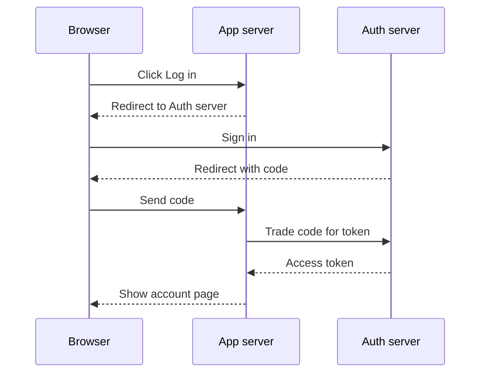
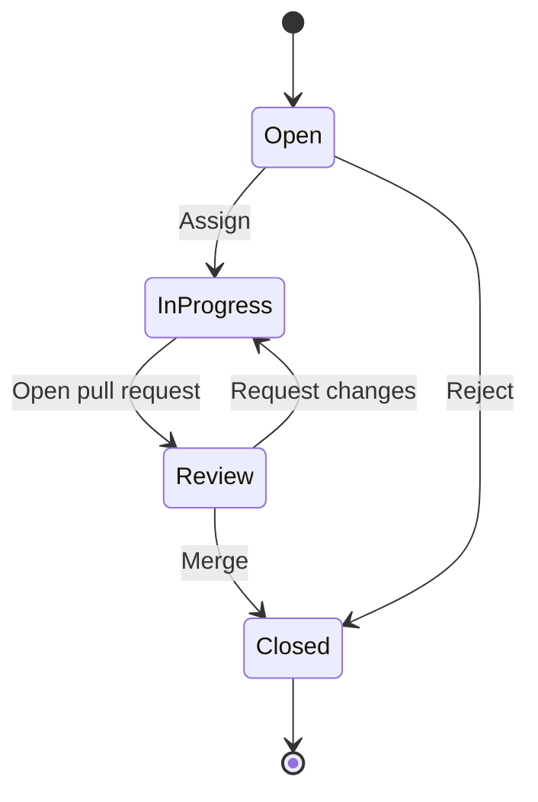
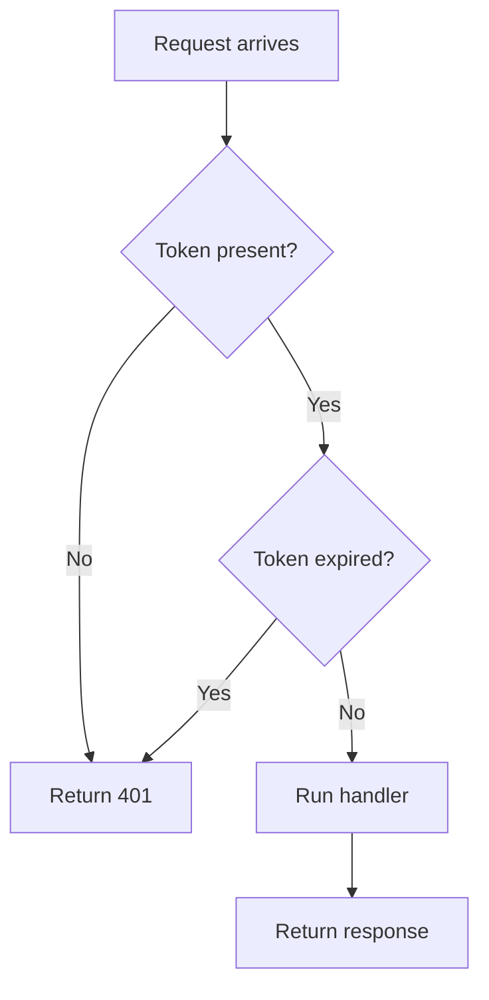
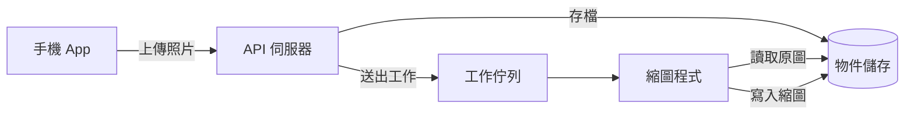
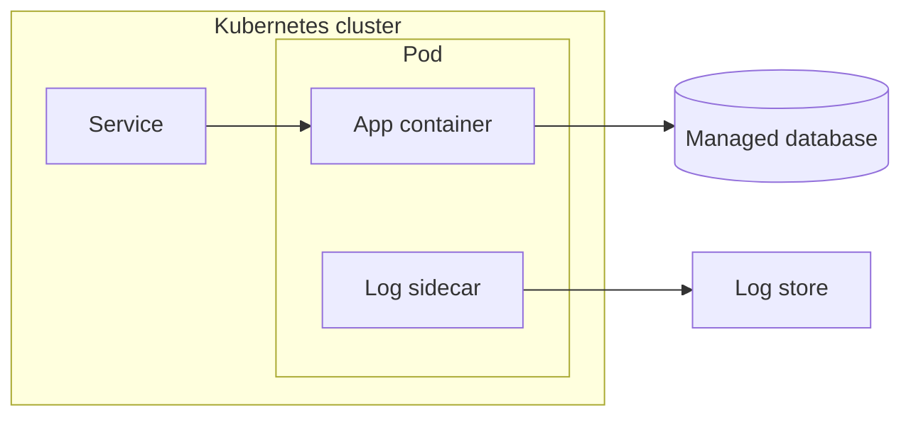

# Diagram types

Pick the type from the question the diagram answers, not from the topic. One topic can need two types: "How does OAuth work?" is a sequence (who sends what to whom), but "What states does a token go through?" is a state diagram.

| The question is about | Type | Header |
| --- | --- | --- |
| Who talks to whom, in order over time ("What happens when ...?") | Sequence | `sequenceDiagram` |
| The states of one thing and what moves it between them ("What states does ... go through?") | State | `stateDiagram-v2` |
| Steps and decisions ("How do I ...?", "How does ... decide?") | Flowchart, top down | `flowchart TD` |
| Data that moves through components ("Where does the data go?") | Flowchart, left to right | `flowchart LR` |
| What contains what ("What runs where?", "What is inside ...?") | Flowchart with subgraphs | `flowchart TD` or `flowchart LR` plus `subgraph` |

Budgets for every type: 12 nodes or fewer (flowchart nodes, state diagram states), 6 participants and 12 messages or fewer (sequence), and labels of 5 words or fewer or 10 CJK characters or fewer. A topic that does not fit gets split into at most 3 diagrams, one concept each.

Each example below passes `scripts/diagram_check.py`. Each one has the caption line that goes into `caption.md`.

## Sequence: who talks to whom over time

Caption: Follow the code: the browser carries it, but only the app server trades it for a token.

## State: the lifecycle of one thing

Caption: Look at Review: an issue can go back to work many times before it closes.

## Flowchart TD: steps and decisions

Caption: Two checks stand before the handler; a failed check returns 401.

## Flowchart LR: data through components (zh-TW)

Caption: 看佇列：API 伺服器不等縮圖完成就回應。

## Flowchart with subgraphs: what contains what

Caption: The database and the log store sit outside the cluster; only the pod reaches them.
