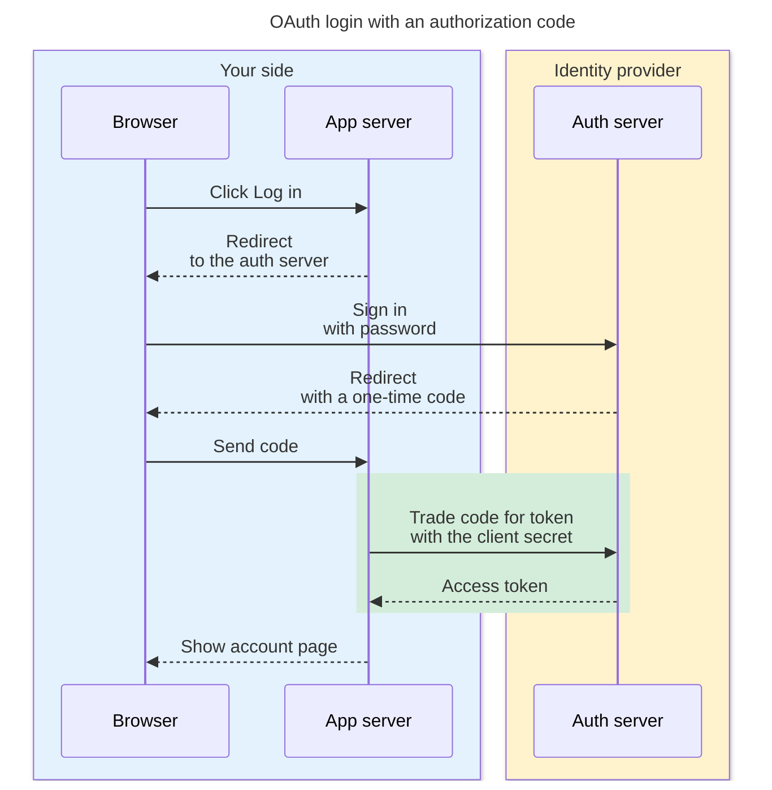
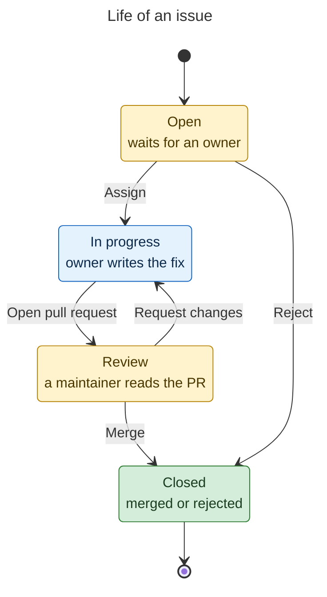
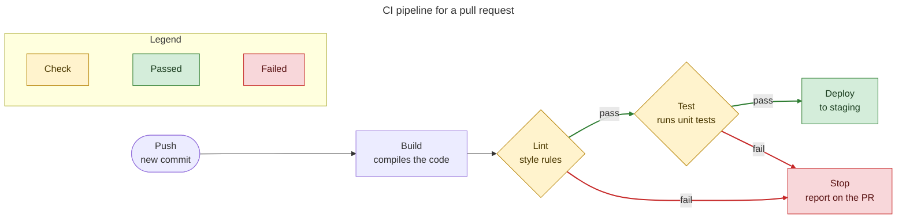
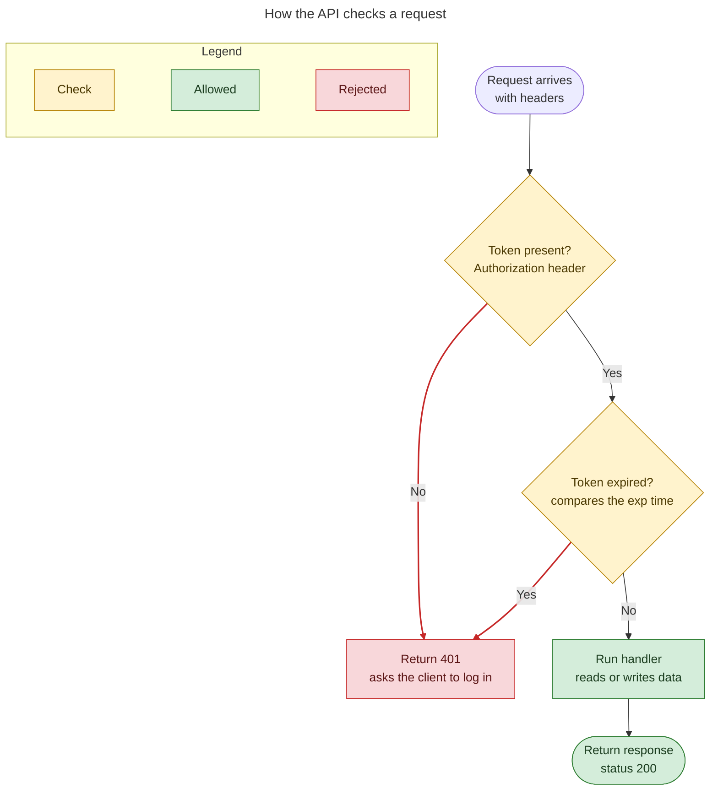
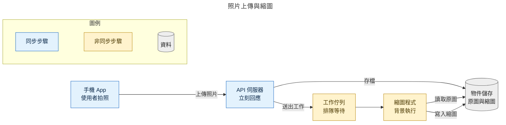
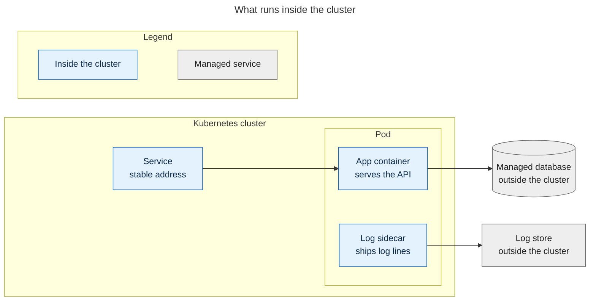

# Diagram types

Pick the type from the question the diagram answers, not from the topic. One topic can need two types: "How does OAuth work?" is a sequence (who sends what to whom), but "What states does a token go through?" is a state diagram.

| The question is about | Type | Header |
| --- | --- | --- |
| Who talks to whom, in order over time ("What happens when ...?") | Sequence | `sequenceDiagram` |
| The states of one thing and what moves it between them ("What states does ... go through?") | State | `stateDiagram-v2` |
| A chain of stages, with or without pass/fail checks: a pipeline, data that moves through components ("What are the steps?", "Where does the data go?") | Flowchart, left to right | `flowchart LR` |
| A process where the branching is the point ("How does ... decide?", "What happens if ...?") | Flowchart, top down | `flowchart TD` |
| What contains what ("What runs where?", "What is inside ...?") | Flowchart with subgraphs | `flowchart LR` or `flowchart TD` plus `subgraph` |

A pipeline stays `flowchart LR` even when it has checks that can fail: the stages read as a line, and the failure exits go to the side. Use `flowchart TD` only when the decisions are what the reader must follow.

## Size

There is no fixed node budget. Put in every step or part that the question needs, and leave out detail that does not help answer it. The checker warns above about 20 nodes or states (sequence: about 8 participants or 20 messages). A warning does not fail the check. Split the topic into at most 3 diagrams, one concept each, only when the layout check of the rendered image shows that the diagram is hard to read.

## Style

Every example below has:

- **A title** in the front matter (`title:`). It names the topic.
- **Two-line labels** where a detail helps: a short name, ` `, then one detail ("Test runs unit tests"). Name line: about 5 words or 10 CJK characters. Detail line: about 8 words or 16 CJK characters.
- **Colors with one fixed meaning** in each diagram, set with `classDef` and `class` (flowchart, state) or `box` and `rect` (sequence). Use the palette in `mermaid-syntax.md`. Give one color to each kind of part or result, for example pass green and fail red. Color edges with `linkStyle` when the path matters.
- **A legend** that explains each color: a small `legend` subgraph in a flowchart, or the caption line in a sequence or state diagram.

Each example below passes `scripts/diagram_check.py` and renders with `scripts/render_diagram.py`. Each one has the caption line that goes into `caption.md`.

## Sequence: who talks to whom over time

Caption: Follow the code: the browser carries it, but only the app server trades it for a token (green: the step that uses the client secret).

## State: the lifecycle of one thing

Caption: Look at Review: an issue can go back to work many times before it closes (yellow: waits for a person, blue: work, green: done).

## Flowchart LR: a pipeline with pass/fail checks

Caption: Follow the green path: a commit reaches staging only after both checks pass; any failed check stops the run.

## Flowchart TD: branching is the point

Caption: Two checks stand before the handler; each red path returns 401.

## Flowchart LR: data through components (zh-TW)

Caption: 看佇列：API 伺服器不等縮圖完成就回應。

## Flowchart with subgraphs: what contains what

Caption: The database and the log store sit outside the cluster; only the pod reaches them.
